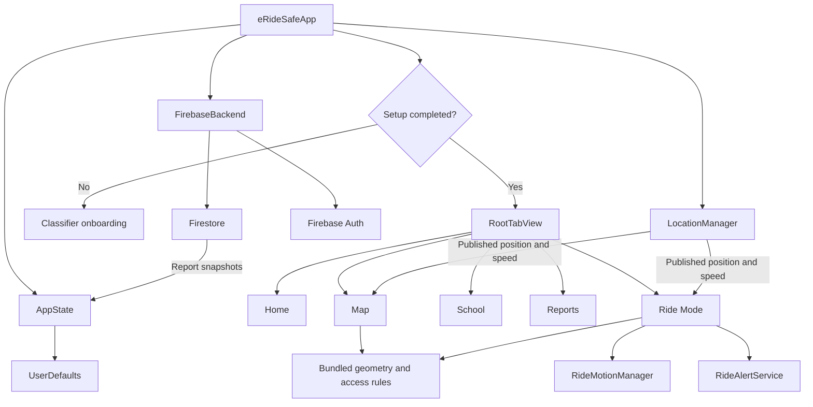

# eRideSafe: architecture and code walkthrough

This guide explains the source in this workspace as inspected on October 11, 2026. It assumes you already know Swift. It covers the app's 26 Swift files, its Firebase rules, resources, build configuration, and maintenance scripts. Repeated styling and static content are explained by purpose; the control flow, state transitions, and algorithms receive more detail.

Statements about classification and access below describe the policy encoded in this version of the app. They do not independently verify current law. Source inspection establishes client behavior; it cannot establish the deployed Firebase rules, enabled authentication providers, or live service health.

## 1. The architecture you actually have

eRideSafe is a native SwiftUI application targeting iOS 17+, with an app-wide observable state object, feature views that coordinate behavior, small domain models, and services wrapping Apple and Firebase APIs. There is no custom HTTP server in this repository. The iPhone talks directly to Firebase Authentication and Cloud Firestore.

It has some MVVM-like separation, but there is no separate view model for each feature. `RideModeView`, `NewReportView`, and `QuizView` contain orchestration and business decisions as well as presentation. `AppState` is the shared store, a persistence adapter, and a set of mutation helpers. `FirebaseBackend` combines authentication, profile writes, report migration, report reads/writes, photo storage, and status reporting.



Arrows show dependencies or data movement, not exclusive ownership. All descendant views can access the three environment objects, although each view declares only those it uses.

### Ownership and lifetime

| Object or state | Owner | Lifetime and consequence |
|---|---|---|
| `AppState` | `eRideSafeApp` via `@StateObject` | Survives ordinary view reconstruction and switching between onboarding and tabs. |
| `LocationManager` | `eRideSafeApp` via `@StateObject` | One shared location service is used by Map, Reports, and Ride. Starting or stopping it affects all consumers. |
| `FirebaseBackend` | `eRideSafeApp` via `@StateObject` | One startup guard and one community-report listener for the app instance. |
| `RideMotionManager`, `RideAlertService` | `RideModeView` via `@StateObject` | Their lifetime follows the identity of that Ride view, rather than the entire app. |
| Classifier answers, quiz selections, form drafts, map layers, checklist | Individual views via `@State` | Survive recomputation for the same view identity, but are not durable storage. |
| Road geometry, lessons, questions | Static model data | Bundled with the app; changing them normally requires shipping a new build. |

`@StateObject` owns stable storage for an observable reference within the declaring container's identity; it does not mean the class can never be recreated. That distinction matters when the entire root tab subtree is removed by restarting setup. [Apple's StateObject reference](https://developer.apple.com/documentation/swiftui/stateobject).

### The dependency boundaries are pragmatic

Views read shared state directly and can mutate its public published properties. There is no enforced reducer/action layer. `DeviceClass` and `RideZone` import SwiftUI because they expose colors, so domain policy and presentation are coupled. Several different views perform their own interpretation of shared values: for example, Home calls a rider certified whenever `certificateDate != nil`, while School additionally requires completion of the current lesson set.

## 2. Startup and navigation

Sources: [eRideSafeApp.swift][app], [RootTabView.swift][root], [AppState.swift][state].

`FirebaseAppDelegate.application(_:didFinishLaunchingWithOptions:)` checks whether `GoogleService-Info.plist` exists in the application bundle. If it does, it calls `FirebaseApp.configure()`. The test establishes resource presence, not whether authentication and Firestore are correctly configured remotely.

`eRideSafeApp` creates the three long-lived state objects. Its `WindowGroup` reads `appState.hasCompletedBikeSetup`:

- `false` constructs `OnboardingClassifierView`.
- `true` constructs `RootTabView`.

The environment objects are attached outside that conditional, so both branches share them. Transitions and the animation modifier animate changes to the setup flag; they do not drive the decision.

The outer `.task` calls `await firebaseBackend.start(appState:)`. Startup is asynchronous, so cached local state can render while cloud work proceeds. The backend's `hasStarted` guard prevents ordinary repeated starts, but is set before any network work succeeds. A failure therefore needs `retry(appState:)` to clear it.

Five `.onChange` handlers observe setup completion, selected class, class-save date, completed lesson IDs, and certificate date. Each calls `syncProfile()`, which starts an unstructured `Task` and attempts to upload the full profile. There is no debounce, write coalescing, or sequence/version check. One logical action such as `saveDeviceClass` can change several observed properties and trigger several attempts. Main-actor isolation serializes synchronous state access, but tasks can interleave at `await` boundaries.

`RootTabView` creates Home, Map, School, Report, and Ride tabs. Every tab wraps its content in `AppNavigationRoot`, which creates an independent `NavigationStack` and adds a Settings link. Tab selection itself is left to SwiftUI; there is no shared router or explicit navigation-path model.

`SettingsView` lives privately in the same file. It displays the saved classification, save date, requirements, progress counts, report count, and backend status. Retaking classification pushes `DeviceClassifierView`. Restarting setup changes only `hasCompletedBikeSetup`; it does not delete lessons, reports, or the saved class. The root conditional then removes the tab subtree and presents onboarding.

## 3. AppState and persistence

[AppState.swift][state] declares two preference enums and the shared observable store.

`RideAlertMode` provides display text/icons and `usesHaptics`/`usesSound` predicates. `RideAlertSound` supplies the three sound choices. These enums do not play anything; `RideAlertService` consumes them.

### Stored state

| Property | Default when absent | Persisted representation | Cloud profile? |
|---|---|---|---|
| `hasCompletedBikeSetup` | `false` | Boolean | Uploaded |
| `selectedDeviceClass` | `.class2` | Enum raw string | Uploaded |
| `deviceClassSavedAt` | `nil` | Date | Uploaded if non-nil |
| `completedLessonIDs` | Empty set | Array of integers | Uploaded as sorted array |
| `certificateDate` | `nil` | Date | Uploaded; nil becomes cloud null |
| `rideAlertMode` | `.haptics` | Enum raw string | Local only |
| `rideAlertSound` | `.chime` | Enum raw string | Local only |
| `reports` | Empty array | JSON-encoded array as `Data` | Separate report collection |

The initializer reconstructs values from `UserDefaults`. Unknown enum strings fall back to defaults. If report decoding fails, the app uses an empty report array. There is no partial-record recovery or explicit schema migration.

Every published property has a `didSet` persistence hook. `@Published` drives view invalidation; `didSet` saves the value. They serve separate purposes. In particular, `@Published` alone would not survive process termination.

`AppState` is `@MainActor`, so its synchronous persistence work runs on that actor. Every report-array mutation can JSON-encode the whole array. This is straightforward, but attaching many large local photos increases both serialization work and preferences storage size.

### Mutation methods

| Method | Exact behavior |
|---|---|
| `saveDeviceClass` | Sets class, sets save time to now, marks setup complete. It does not retain the questionnaire answers or classification reasons. |
| `restartBikeSetup` | Clears only the setup-complete flag. |
| `markLessonComplete` | Inserts the lesson ID into a set, so repeating completion cannot create a duplicate. |
| `addReport` | Delegates to `upsertReport`. |
| `upsertReport` | Replaces a report with the same UUID, or appends it, then sorts newest first. |
| `removeReport` | Removes all entries matching a UUID. |
| `replaceReportsFromCloud` | Replaces the cloud-backed portion with the latest snapshot, while preserving local reports with `ownerUID == nil` whose IDs are absent from the snapshot. |
| `saveReports` | Encodes the entire array with `JSONEncoder` and writes it to preferences; silently returns if encoding fails. |

The merge rule is specifically:

```swift
let cloudIDs = Set(cloudReports.map(\.id))
let localOnly = reports.filter {
    $0.ownerUID == nil && !cloudIDs.contains($0.id)
}
reports = (cloudReports + localOnly).sorted { $0.createdAt > $1.createdAt }
```

This is snapshot replacement with preservation of unsynced local records. It is not a field-by-field merge. Cloud-backed reports that disappear from the listener's limited query disappear from `AppState`, even if the document still exists outside that query's newest 250 records.

### A complete state propagation example

When the Map class selector assigns `appState.selectedDeviceClass = .class3`, the assignment persists through `didSet`, publishes a change to observers, changes the colors and rules computed by Map and Home, changes the class used by Ride, and is observed by the app root's profile-upload handler. It does **not** call `saveDeviceClass`, so `deviceClassSavedAt` remains unchanged. This selector currently edits the rider's actual saved class; it is not an isolated preview filter.

## 4. Device classification

Sources: [DeviceClass.swift][device], [ClassifierModels.swift][classifier-model], [DeviceClassifierView.swift][classifier-view].

`DeviceClass` is a Codable raw-string enum with four outcomes. Its computed properties centralize labels, SF Symbols, colors, summaries, and requirement strings used throughout the UI. Those strings are static app content.

`ClassifierAnswers` is an in-memory value containing pedal, throttle, motor-only speed, wattage, assisted-speed, speedometer, and modification answers. `AssistedSpeed` groups speed into three bands. `ClassificationResult` holds the chosen class and explanation strings.

### ClassificationEngine.classify

This is a deterministic decision tree with no network request, sensor reading, image recognition, or machine learning.

1. Collect reasons for no functional pedals, wattage above 750, throttle-only speed above 20 when a throttle exists, assistance above 28, or performance modification.
2. If any reason exists, return `.electricMotorcycle` with all collected reasons.
3. Otherwise, if a throttle exists, return `.class2` immediately.
4. Otherwise, if assisted speed is above 20 through 28, return `.class3` when a speedometer exists; return `.electricMotorcycle` when it does not.
5. Otherwise return `.class1`.

Order is part of the specification. A throttle-equipped answer set with motor-only speed at or below 20 and assisted speed in the 20–28 band reaches the Class 2 branch before any Class 3 branch. Also, `.electricMotorcycle` acts as the app's broad fallback for failing its e-bike rules, including the missing-speedometer case. There is no separate “unknown,” “invalid answers,” or “noncompliant e-bike” result.

### How the questionnaire gets there

`ClassifierQuizStep` supplies each question's title, explanation, icon, and accent. `ClassifierQuizFlow` owns `answers`, `answeredSteps`, and `currentIndex`.

The `steps` array is computed dynamically. The normal questions are pedals, throttle, wattage, assisted speed, and modifications. A throttle answer inserts a motor-only-speed question. A no-throttle answer with assisted speed in the 20–28 band inserts a speedometer question. The user sees five or six questions on these branches.

`answeredSteps` distinguishes an intentional answer from the defaults in `ClassifierAnswers`. Without that set, the default `hasFunctionalPedals = true` could incorrectly count as a submitted answer. Continue is enabled only for an answered current step.

`safeIndex` clamps the current index after the list of questions changes. The throttle control clears an obsolete motor-only-speed answer when throttle becomes false. Assisted-speed controls remove the speedometer step and reset its answer when it is irrelevant. `advance()` either advances to the next step or calls the pure classification engine and hands the result to `onComplete`.

`progressHeader`, `questionHeader`, `yesNoChoices`, `navigationButtons`, and `ClassifierChoiceButton` implement reusable presentation around those transitions. `.id(currentStep)` gives the answer region a new identity per step to support its transition. `WattageOption.options` maps UI choices to 250, 500, 750, or 1,000; 1,000 represents the whole “more than 750W” category.

The two entry points intentionally save at different moments:

- `OnboardingClassifierView` presents a result sheet first. `OnboardingResultView` calls `saveDeviceClass` only when the user chooses to enter the app. The sheet disables interactive dismissal.
- `DeviceClassifierView` saves immediately when the quiz completes, then presents `ClassificationResultView` explaining the already-saved result.

The `ClassificationResult: Identifiable` extension constructs sheet identity from class and reasons. The normal result view displays reasons; the onboarding result primarily displays the class summary and requirements.

## 5. Map models, geometry, and access rules

Sources: [RideZone.swift][zone], [SafetyMapData.swift][map-data], [map-data.md][map-notes].

The map has two separate inputs: facility geometry says **where a feature is**; app policy says **what message to show for a device class**. Neither road color nor geometry is a live measurement of danger.

### Model types

| Type | Responsibility |
|---|---|
| `ZoneLevel` | Describes road/path category or traffic-stress presentation. |
| `RideFacilityType` | Distinguishes paved shared paths, roadways, and natural-surface trails. |
| `RidePermission` | Carries allowed, caution, conditional, or prohibited status plus a message, icon, and color. |
| `RideZone` | Combines geometry, facility, level, matching tolerance, optional speed limit, explanatory text, and provenance. |
| `SafetyMapLine` | Lower-level geometry record with source ID, name, context, coordinates, and provenance. |
| `SchoolSafetyArea` | School point plus an internal proximity radius. |
| `NearbySafetyContext` | Tagged result for a nearby restricted trail, school, or caution road. |

`RideZone.id` is a generated UUID, stable while its static array instance is alive, but not a durable source ID across launches. `SafetyMapLine.id` preserves source-based identities such as a city feature/path identifier.

`RideZone.permission(for:)` is the single access-policy function used by Home, Map, details, and Ride messages. In this code, the two shared paths allow Classes 1/2 and prohibit Class 3/motorcycles; natural-surface facilities return prohibited for all classes; roadways allow Classes 1–3 with differing caution messages, and give motorcycles conditional access. Class 3 roadway messages add the age requirement.

`ZoneLevel.color` and `RidePermission.color` are different mappings. The main map renders **permission color**: even a principal arterial with `.red` level returns `.caution`, whose color is orange. Therefore “red-level road” does not mean the map draws it red or prohibits it.

### Bundled data

This snapshot contains 2,228 local-road paths, 334 arterial/collector paths, two explicitly modeled shared paths, 93 restricted-trail paths, and 17 school markers. A path is a geometry piece, not necessarily a complete named road.

`SammamishZones.sharedPaths` contains explicit coordinates for East Lake Sammamish Trail and the 228th Avenue east-side shared path. Both have a 12 m matching tolerance and a stored 15 mph limit.

`SammamishZones.roadways` converts local/caution `SafetyMapLine` records into `RideZone` values. It derives `.red` from “principal,” `.orange` from “arterial” or “collector,” and `.green` otherwise. Roadways use an 18 m matching tolerance and `speedLimitMPH = nil`. No road speed is inferred from road category.

`SammamishZones.all` combines shared paths and roadways. Restricted trails remain in `SafetyMapData`; they are not included in this array. As a result, Ride Mode's `currentZone` does not identify natural-surface trail zones, although Map can display restricted-trail proximity context.

Most of `SafetyMapData.swift` is generated tab-separated data inside Swift raw multiline strings. Each street row contains source ID, name, classification context, and encoded geometry. These thousands of lines are data records using the same decoder, not thousands of distinct algorithms.

`decodeStreetRows` splits each row into four fields, traps with a precondition if the generated format is wrong, then decodes coordinates at precision 1,000,000. Older trail strings use precision 100,000 through the `line(...)` helper.

`decodePolyline` reads 5-bit chunks from characters after subtracting 63, reconstructs a signed delta, adds it to the previous integer latitude/longitude, and divides by precision. Delta encoding saves space because nearby coordinates have small differences. The parser returns completed coordinate pairs; it is intended for trusted bundled strings, not hardened arbitrary input.

### Point-to-polyline distance

`RideZone.distance(to:)` computes the minimum distance to every line segment, using `MKMapPoint` for projection. `SafetyMapLine.distance` repeats essentially the same algorithm.

For location P and segment A→B:

```text
v = B - A
t = clamp(dot(P - A, v) / dot(v, v), 0, 1)
closest = A + t * v
distance = distance in meters from P to closest
```

Clamping keeps the closest point on the finite segment. A zero-length segment uses its start point. Empty geometry returns the largest finite distance; a one-point geometry measures directly to that point. The result is the smallest segment distance, rather than distance to the feature's midpoint marker.

### Automatic matching

`SammamishZones.nearestZone` computes and sorts distances for all candidate zones. It rejects the nearest candidate if outside that candidate's own tolerance. It then rejects the result if any candidate of a different facility type is less than 8 m farther away. This avoids asserting whether a point between parallel road/path geometry is on one or the other.

For parallel lines 20 m apart, a point 2 m from the path and 18 m from the road clearly selects the path. A point 10 m from each returns nil. If the absolute nearest path is outside its 12 m tolerance, the function returns nil rather than skipping it and snapping to a farther road that happens to fit an 18 m tolerance.

Map and Ride add a separate requirement: reported horizontal accuracy must be between 0 and 12 m. This gate is distinct from both geometry tolerances. Neither consumer adds a coordinate timestamp check.

### Context lookup

`SafetyMapData.nearbyContext` first looks for a restricted trail within 12 m, accepting it only if it is more than 8 m closer than any roadway/shared path. Otherwise it picks the closest school whose 300 m radius contains the point. Otherwise it checks for a caution road within 18 m.

Those school radii are internal awareness heuristics. The UI draws school point markers, not 300 m circles or asserted legal speed-zone boundaries. `nearestLine` performs filtering and a minimum-distance selection; `SchoolSafetyArea.contains` compares point distance to its radius.

## 6. SafetyMapView and HomeView

Sources: [SafetyMapView.swift][map-view], [HomeView.swift][home].

### Rendering and interaction

`SafetyMapView` owns camera position, the last settled visible region, sheet selections, pending browser selections, and layer toggles. Those are view-local. The selected device class is shared application state.

`MapRoadFeature.roads` precomputes road bounding rectangles. The rectangles expand by one map point to avoid zero-area bounds for perfectly horizontal or vertical segments. `visibleRoads` filters them by viewport intersection and layer settings. Local roads additionally require a latitude span below 0.045 degrees. `onMapCameraChange(frequency: .onEnd)` updates visibility after a camera gesture ends.

The map content builds user location, culled road polylines, restricted-trail dashed lines, shared-path polylines and buttons, school annotations, and the first 150 community reports that fall within the selected prefix and have coordinates. Reports have no spatial filtering in that prefix selection.

`MapReader` supports hit-testing polylines manually. A tap is converted to a geographic coordinate; a second point 16 screen points to the right determines a distance tolerance capped at 45 m. The closest visible roadway/shared path within that tolerance opens a detail sheet. This intentional selection does not use the automatic GPS ambiguity rule. Restricted trail lines are not candidates for this tap handler.

The layer menu toggles Apple standard/hybrid imagery, Apple's traffic rendering, and local overlay visibility. Live traffic is a basemap feature; it does not change `ZoneLevel`, the app's permissions, or its alert thresholds.

### Status and sheets

`currentSafetyStatus` applies the location-accuracy gate, obtains nearby context, gives school context an early display path, then tries a matched `RideZone`, then falls back to restricted-trail/caution-road context. Since `nearbyContext` itself can prioritize a restricted trail over a school, this is not simply “schools always win.”

`ZoneDetailView` shows selected-class access, access for all classes, explanatory text, any mapped limit, and source links. `SchoolMapDetailView` shows a school reminder and explains the point marker's meaning. `SafetyStatus` is a small presentation payload for the footer.

`MapPlaceBrowser` searches the bundled strings with `localizedStandardContains`. It does not call geocoding or a search API. It lists each road name once by retaining the first matching name encountered in `SammamishZones.roadways`. Choosing a road therefore focuses one retained segment rather than the whole street's union of geometries.

Browser selections go into `pendingZone`/`pendingSchool`, close the browser, and only move the camera from `applyBrowserSelection` on dismissal. This avoids framing for the reduced sheet viewport. `focus(on:)` enables the appropriate layer and frames the chosen geometry with padding. A selected school enables the school layer and frames a 700-by-400-meter region. Browser selection focuses the map; it does not itself open the detail sheet.

`mapFooter` assembles current context, a legend derived from enabled layers and class, and a reset-camera button. `legendItem` is purely visual. The `MKMapRect(region:)` extension converts the local region's northwest/southeast corners for culling; it is tailored to this city's geography, with no special handling for crossing the date line.

### Home

`HomeView` reads class and progress, then renders `heroCard`, `schoolSection`, `mapSection`, and `safetyNotice`. Its preview includes caution roadways, shared paths, restricted trails, and schools. It omits local streets and community reports. `.allowsHitTesting(false)` turns the preview map into a visual inside a navigation link.

Home links push new School or Map views within Home's navigation stack. They do not switch the selected tab. Those pushed views have their own local UI state, while sharing `AppState` and `LocationManager` with the tab versions.

## 7. LocationManager: position, speed, and sample filtering

Source: [LocationManager.swift][location].

This `NSObject` implements `CLLocationManagerDelegate` and publishes position, authorization, speed, speed accuracy, speed availability, horizontal accuracy, and the last error. External readers can observe these properties but cannot set them because of `private(set)`.

Initialization installs the delegate, requests best accuracy, chooses fitness activity, uses a 2 m distance filter, and disables automatic pausing. `requestPermission` requests when-in-use permission. `startUpdating` checks whether location services are globally enabled, then starts updates. `requestSingleLocation` requests authorization if needed; the authorization delegate requests a single fix after permission is granted.

`startRideTracking` switches to best-for-navigation accuracy and no distance filter, resets speed-filter history, and starts updating. `stopUpdating` stops updates, restores normal accuracy/filter settings, and clears speed state. It does not clear the saved coordinate, horizontal accuracy, or last error.

On each callback, the last delivered `CLLocation` becomes the shared coordinate and horizontal accuracy **before** speed validation. A bad speed sample can therefore still update position.

Speed is usable when all these predicates hold:

- `location.speed >= 0`.
- Absolute timestamp age is at most 5 seconds.
- Horizontal accuracy is between 0 and 65 m.
- Speed accuracy is either unavailable (negative) or at most 3.5 m/s.

Speeds below 0.3 m/s are treated as zero. Accepted samples use an exponential moving average:

```text
smoothed = alpha * raw + (1 - alpha) * previous
alpha = 0.45 when known speed accuracy <= 1.25 m/s
alpha = 0.25 otherwise
mph = max(0, smoothed * 2.236936)
```

The first valid sample initializes the filter directly. Larger alpha reacts faster; smaller alpha suppresses more jitter but adds lag. The output can remain above zero for several samples after a stop, and top speed measures this filtered value rather than raw peaks.

For an invalid sample, speed becomes unavailable if more than five seconds have elapsed since the last valid sample. This expiration is evaluated only when another location callback arrives. There is no timer to expire speed when callbacks stop completely, and no coordinate freshness field published to Map/Ride. `locationUnknown` errors are ignored; other failures populate `lastError` without explicitly invalidating speed.

Location's speed gate permits up to 65 m horizontal uncertainty, whereas facility matching requires at most 12 m. Thus a live speed with an unconfirmed road/path is an expected combination.

## 8. RideMotionManager and RideAlertService

Sources: [RideMotionManager.swift][motion], [RideAlertService.swift][alerts].

### Motion processing

`RideMotionState` provides labels/icons for unavailable, steady, normal, rough, and sudden states. `RideMotionManager` wraps `CMMotionManager`, owns a serial `OperationQueue`, and publishes both numerical measurements and a state category.

`start()` checks availability and prevents double-starting. It requests device-motion updates at 25 Hz using `.xArbitraryZVertical`. The callback weakly captures the manager, then schedules a `Task { @MainActor in ... }` to process values and publish changes. The data queue therefore delivers samples, but the actual magnitude/filter calculations run on the main actor.

`process` uses `motion.userAcceleration`, whose gravity component is removed, and computes:

```text
instantaneous = sqrt(x*x + y*y + z*z)
smoothed = 0.22 * instantaneous + 0.78 * previous
peak = max(peak, instantaneous)
```

It uses magnitude, so classification does not depend on which phone axis points forward. These are measurements of phone movement and cannot distinguish a pothole, a hand movement, or a collision by themselves.

| Condition, evaluated in order | State or event |
|---|---|
| Instantaneous acceleration >= 0.65 g | `.sudden`; increment event count only if at least 2 seconds since the previous counted event |
| Smoothed acceleration >= 0.25 g | `.rough` |
| Smoothed acceleration >= 0.07 g | `.normal` |
| Otherwise | `.steady` |

The cooldown gates `significantMotionCount`, not the `.sudden` state itself. Ride listens to count changes to trigger alerts. `stop()` stops sampling and clears displayed acceleration and peak. Neither `start` nor `stop` resets the significant-event count or its last-event timestamp, so they persist for that manager instance across rides.

### Haptics and generated audio

`RideAlertEvent` defines zone-change, speed-limit, sudden-motion, and preview events. Each maps to timed haptic pulse tuples. For example, overspeed uses three pulses at 0, 0.17, and 0.34 seconds.

`RideAlertService.init` attaches an audio player node to a 44,100 Hz mono engine and prepares a haptic engine if supported. `play` chooses haptics and/or sound using the user's preferences.

`playHaptics` converts pulse tuples into transient Core Haptics events. Unsupported hardware or playback errors fall back to `UINotificationFeedbackGenerator`. There is no engine reset/stopped-handler recovery strategy beyond starting the stored engine again and falling back on failure.

`playSound` configures an ambient audio session that mixes with other audio, starts the engine if necessary, stops the prior player sound, schedules a generated PCM buffer, and plays it. Alert events have different haptic patterns, but the sound is chosen only by `RideAlertSound`; zone and speed alerts use the same selected tone sequence.

`makeBuffer` chooses frequency/duration/gap tuples for chime, pulse, or urgent. It zeros the buffer, then fills tone frames using a sine fundamental plus a second harmonic at 18% amplitude. Attack/release envelopes taper the ends, and the result is scaled by 0.2. Gaps retain zero-valued samples. There are no bundled alert audio files.

Sound playback failure also falls back to haptics, even if the selected preference is sound-only. The service has no speech synthesizer; the Ride view separately makes an accessibility announcement for overspeed when VoiceOver is enabled.

## 9. RideModeView as a state machine

Source: [RideModeView.swift][ride].

This view owns the checklist, active/inactive state, top speed, last overspeed state, last zone name, and the two ride-only services. It coordinates sensor input and alerts directly.

`checklistComplete` requires helmet, front light, rear reflector/light, brakes, and secured phone. Start is disabled unless all are true and the saved device class is not `.electricMotorcycle`.

Start requests location permission, starts ride tracking, starts motion, resets top speed and overspeed history, records the current zone name, and sets `isRiding = true`. It does not wait for permission, a valid GPS speed, or motion availability before entering the active UI.

`currentZone` applies the 12 m horizontal-accuracy gate and calls `nearestZone`. `speedLimit` reads its optional stored limit. `speedState` evaluates:

```text
No available speed       -> acquiring
No mapped speed limit    -> unmapped
Speed > limit            -> over
Speed >= 0.85 * limit    -> approaching
Otherwise                -> safe
```

For a 15 mph path, approaching begins at 12.75 mph; exactly 15 is still approaching, and greater than 15 is over. A matched roadway still produces `unmapped` because road speed limits are nil. That enum case means an unmapped **limit**, not necessarily an unmapped road.

Three observers drive runtime reactions:

1. Speed change: while riding with valid speed, update top speed and evaluate overspeed warning.
2. Significant-motion count increase: while riding, play the sudden-motion alert.
3. Current zone name change: while riding, reevaluate overspeed, remember the new name, and play a zone alert only when the new name is non-nil.

`triggerWarningIfNeeded` implements an edge detector: alert only when the current state is over and `lastWarningState` was false; then store whether it is over. Sustained overspeed does not repeat the alert. There is no hysteresis, so oscillating above/below the threshold can retrigger it. Same-name segment changes do not produce zone-change alerts because the observed key is the name.

`zoneMessage` displays access policy and, for roads, an extra note that the speed limit is unmapped. A prohibited access result does not have its own enforcement or special prohibition-alert branch. A Class 3 rider can see a prohibited-path message and still receive an “under limit” speed status; those describe different dimensions.

`speedDisplay`, `gpsStatusText`, `motionStateColor`, and `sensorExplanation` translate service state into text/colors. `alertSettingsCard` writes preferences directly through `AppState` bindings and permits preview playback. `checklistToggle` is a reusable binding-based row.

`shareLocationURL` constructs an Apple Maps URL with the latest coordinate. Sharing sends a location snapshot; there is no live tracking session or recipient update stream.

End Ride sets the local active flag false and explicitly stops location and motion. There is no `.onDisappear` cleanup, scene-phase handler, background-location configuration, ride-history storage, or route recording. Treat sensor lifecycle as tied to these explicit calls, rather than assuming tab changes or backgrounding implement a complete ride-session lifecycle.

## 10. Lessons, assessment, and certification

Sources: [Lesson.swift][lessons], [QuizQuestion.swift][questions], [SchoolView.swift][school], [LessonDetailView.swift][lesson-detail], [QuizView.swift][quiz], [CertificateView.swift][certificate].

### Content models

`Lesson` stores an integer ID, title/subtitle/icon, estimated time, learning goals, sections, and a takeaway. `LessonSection` stores heading/icon/body/key points and a UUID for UI identity. The six lessons are Know Your Ride, Rules of the Road, Speed = Danger, Gear Up, Sammamish Smart Riding, and Defensive Riding. Their displayed estimates total 35 minutes; there is no timer enforcing those estimates.

`CourseContent.lessonIDs` derives the current course's ID set. `completedLessonCount` uses intersection so obsolete IDs cannot inflate progress. `hasCompletedEveryLesson` tests whether all current IDs are included in the saved set. Adding a new lesson with a new ID therefore requires that new completion before School unlocks assessment/certificate navigation.

`QuizQuestion` contains category, optional scenario, prompt, answers, correct answer index, and explanation. `isScenario` is simply `scenario != nil`. `QuizContent.questions` is a fixed ordered array of 15 records, with no randomization, server fetch, or adaptive selection.

### Views and state transitions

`SchoolView` derives completion count, all-complete status, and estimated time. It lists lessons, disables quiz navigation until all are complete, and exposes an existing certificate only when both a certificate date and full current completion exist.

`LessonDetailView` renders its header, goals, numbered section cards, and takeaway. `learningGoals`, `lessonSection`, and `bulletRow` are presentation helpers. Mark Complete directly inserts the ID. There is no read-time measurement, scroll completion condition, or comprehension check at this step.

`QuizView` stores selections as `[questionID: answerIndex]`. `answerButton` updates one dictionary entry. Back/Next changes `currentIndex`; Next is disabled until the current question has a selection. The scroll view's `.id(question.id)` gives each question a new scroll identity. The final button opens results.

`score` reduces the fixed question array, adding one for each selection equal to `correctIndex`. `QuizResultView.passed` requires `score == total`, hence 100%. It filters missed questions and displays the chosen answer, correct answer, and explanation through `missedQuestionCard` and `answerReviewRow`.

On a passing result's `.onAppear`, `certificationAction` sets `appState.certificateDate = Date()`. Re-presenting a passing result can therefore update the date. A failed retake does not clear an earlier certificate. Retry resets quiz index and selections, and closes the result sheet.

`CertificateView` formats the date and renders a badge card. Its `ShareLink` shares plain text, not a generated image/PDF or cryptographically signed credential. Certification is a local achievement with a profile field; the backend does not independently grade a submission.

## 11. Reports: model, form, display, and images

Sources: [SafetyReport.swift][report-model], [NewReportView.swift][new-report], [ReportsView.swift][reports], [ReportDetailView.swift][report-detail].

`ReportCategory` enumerates five categories and maps them to symbols. `SafetyReport` is an immutable Codable/Equatable struct containing UUID, category, notes, optional coordinates, client creation time, optional photo bytes, photo availability, owner UID, and saved device-class raw value.

`hasPhoto` accepts either actual bytes or `photoAvailable == true`; `isCloudReport` checks only for an owner UID. Optional later-added fields preserve decoding of older local records. Neither computed property independently verifies a cloud document exists.

### Form flow

`NewReportView` owns the category, note text, selected picker item, compressed bytes, and loading/error flags. On appearance it asks for permission and a single location. Submit requires a non-nil coordinate; it does not require nonempty notes, fresh coordinates, or a particular accuracy. The model accepts nil coordinates for compatibility even though this UI gates submission.

`.task(id: selectedPhoto)` loads the image's transferable bytes, constructs a `UIImage`, and calls `compressedPhotoData`. Changing the selection cancels the previous SwiftUI task, but there is no explicit cancellation or selection-identity check after the awaited load. Decode/compression failures do not produce a dedicated photo error.

Compression starts with a maximum dimension of 1,200 in image-size units, scales down when needed, and tries JPEG quality from 0.76 downward in 0.08 increments while at least 0.36. If still too large, it multiplies the dimension budget by 0.78 and tries again, for four passes. The final fallback encodes at 0.32 without a final byte-size guard. `UIGraphicsImageRenderer` uses its default rendering scale, so those dimensions should not be treated as an explicit 1,200-pixel output guarantee.

`saveReport` guards duplicate invocation, sets `isSaving`, and uses `defer` to reset the flag. It captures the latest coordinate, trims notes, and creates a fresh UUID report. If Firebase is unconfigured, it saves to `AppState` and shows a local-save notice. Otherwise it awaits backend submission, upserts the returned report, and dismisses. A configured-but-failing backend produces an error; this path does not automatically save a new ownerless local fallback.

### Reports and details

`ReportsView` handles empty state, a sync banner, list/map selection, a new-report sheet, and export. `ReportRow` shows category, notes, time, indicators, and an ownership badge. `exportText` builds CSV-style text with doubled quote characters in quoted notes; `ShareLink` shares that text.

`ReportHeatMap` draws up to 250 reports as red circles with radius 180 m plus category icons. It is an overlapping-circle visualization, with no density estimator, severity score, deduplication, or statistical normalization.

The Retry control lives in the sync banner, and that banner is in the nonempty branch. If there are no reports, the offline retry affordance does not appear there.

`ReportDetailView` receives a report value snapshot. It does not look up the latest report by ID on every render, so its received immutable data need not track later replacements in the shared array. `photoSection` prefers inline bytes, then view-local fetched bytes. `loadPhotoIfNeeded` fetches only when a photo is advertised and no local bytes exist. The fetched data stays in the detail view's state rather than being explicitly written back into `AppState`.

Delete is shown only when the backend recognizes the report's owner as the current user. After confirmation, it awaits cloud deletion, removes the local entry, and dismisses. Ownerless local reports do not expose a local-delete path in this view.

## 12. FirebaseBackend: every operation and the actual data flow

Source: [FirebaseBackend.swift][backend].

The class is `@MainActor` and observable. Network APIs operate asynchronously; this annotation governs isolation of the object's state, not where Firebase transports bytes. `SyncState` supplies UI status and icons; `.offline(String)` retains an error even though its title is generic.

`isFirebaseConfigured` checks for a configured default Firebase app. It does not mean authenticated, online, or permitted by Firestore rules. The optional `database` getter protects access to `Firestore.firestore()` until Firebase exists.

### Startup order

```text
start(appState)
  guard !hasStarted; set hasStarted
  require configured Firebase
  ensureAnonymousUser -> currentUserID
  ensureUserDocument
  migrateLocalReportsIfNeeded
  startReportListener
  updateUserProfile
  mark synced and record local completion time
```

`ensureAnonymousUser` reuses any existing Firebase user. Only when none exists does it call `signInAnonymously`. There is no login, account linking, sign-out UI, or cross-device account-recovery flow in this source. A new independent installation therefore cannot infer the same rider identity.

`ensureUserDocument` reads `users/{uid}` to check existence. It updates last-seen metadata if present; otherwise it creates identity/platform/account metadata. It does not assign any remote profile fields into `AppState`.

`migrateLocalReportsIfNeeded` takes a snapshot of ownerless local reports, uploads them sequentially, and upserts each returned cloud-backed report. Its `uid` parameter is unused; submission reads `currentUserID`. A migration failure throws out of startup before the report listener is installed. Migration uses the class currently selected in `AppState`, because old ownerless reports need not have a saved class.

`retry` removes the old listener, resets `hasStarted`, and runs startup again. There is no explicit application-level automatic retry/backoff loop.

### Firestore schema

```text
users/{firebaseUID}
  uid, accountType, appPlatform, createdAt, lastSeenAt
  deviceClass, hasCompletedBikeSetup, completedLessonIDs
  deviceClassSavedAt?, certificateDate, lastUpdatedAt

reports/{reportUUID}
  category, notes, createdAt, serverCreatedAt
  userId, deviceClass, hasPhoto, appPlatform
  latitude, longitude

reportPhotos/{sameReportUUID}
  userId, bytes, contentType, createdAt
```

`updateUserProfile` uploads a merge dictionary. Nil certificate becomes `NSNull`; nil class-save date is omitted, leaving any prior remote date untouched. `rideAlertMode`, `rideAlertSound`, classifier answers, and individual quiz selections are not uploaded.

Profile flow is one-way: local state → Firestore. Reports flow from writes and snapshots back into the local store. The broad phrase “cloud sync” in the UI does not imply two-way profile reconciliation.

### Report upload and cleanup

`submitReport` requires a database and user ID. It rejects photo bytes above 700,000 by treating them as absent. It then:

1. Writes a photo document first, if acceptable bytes exist.
2. Builds report metadata, using client `createdAt`, server `serverCreatedAt`, nullable coordinate fields, and the current user/class.
3. Writes the report document with the UUID as its document ID.
4. If metadata write throws after photo success, attempts to delete the orphaned photo with `try?`, then rethrows.
5. Returns a new `SafetyReport` containing owner/class/photo flags, and updates status/time.

These are separate operations, not an atomic batch or transaction. Best-effort cleanup can fail. A photo-upload failure aborts before metadata submission; an oversized photo instead gets omitted while the report may succeed.

`fetchPhotoData` returns already-present bytes when possible. Otherwise it reads `reportPhotos/{uuid}` and casts the `bytes` field to `Data`. Photos are stored directly in Firestore documents; Firebase Storage is not a linked app dependency here.

`deleteReport` checks ownership, deletes metadata, and best-effort deletes the photo afterward. It updates the timestamp, but does not independently remove `AppState` data; the caller and report listener handle that.

`isOwnedByCurrentUser` compares UID values for UI behavior. The real authorization boundary is the server's deployed rules.

### Listener and decoding

`startReportListener` attaches one query to reports ordered by client `createdAt` descending, limited to 250. It has no user, distance, city, category, or age filter. The callback weakly captures backend and app state, then hops to the main actor before mutation.

`report(from:)` requires a UUID document ID, a known category string, and notes. Invalid records are silently excluded by `compactMap`. It accepts Firestore `Timestamp` or `Date`; if neither exists, it uses now for the decoded record. `optionalDouble` tolerates null/missing values and bridges Double/NSNumber. Cloud decoding omits photo bytes and keeps only the photo flag for lazy retrieval.

The listener calls `replaceReportsFromCloud`, then sets `.synced` and `lastSyncDate = Date()`. It does not inspect snapshot cache/pending-write metadata. A cached snapshot can therefore be displayed as synced; the timestamp records local callback handling, not proof of server freshness. Firestore exposes cache metadata for distinguishing those cases. [Firestore offline behavior](https://firebase.google.com/docs/firestore/manage-data/enable-offline).

### Async bridges and offline semantics

`ensureAnonymousUser`, `getDocument`, `setData`, and `deleteDocument` adapt completion handlers with `withCheckedThrowingContinuation`. Each callback resumes with a value or error. This allows the higher-level functions to express sequential work with `await`.

The wrappers do not add cancellation handlers or timeouts. In particular, Firestore write completion waits for the server; while offline, a locally queued write does not immediately invoke that completion. Therefore `await setData` can remain suspended and the report form can remain in its saving state despite Firestore's local persistence. This follows from the wrapper and the SDK's documented completion contract. [DocumentReference reference](https://firebase.google.com/docs/reference/swift/firebasefirestore/api/reference/Classes/DocumentReference).

There are two local storage mechanisms: eRideSafe's explicit `UserDefaults` cache and Firestore's SDK-managed persistence, which is enabled by default on Apple platforms. They should be reasoned about separately. [Firestore persistence documentation](https://firebase.google.com/docs/firestore/manage-data/enable-offline).

`BackendError` supplies localized messages for disconnected submission, missing authentication result, missing document snapshot, and ownership rejection.

## 13. Firebase rules and trust boundaries

Sources: [firestore.rules][rules], [firebase.json][firebase-config].

`signedIn()` checks `request.auth != null`. Anonymous Firebase users qualify. User documents allow their matching UID to read/create/update/delete. Reports and report photos allow reads by any authenticated user. Creation requires the proposed `userId` to match the caller; update/delete require the existing document's owner to match.

These rules check ownership but do not validate a field schema, category enum, coordinate range, notes length, image byte limit, timestamp policy, or certificate criteria. They also do not enforce immutable ownership on update by comparing the new `userId`. UI restrictions such as a disabled button are not server-side invariants.

The checked-in rules file is a deployment input. `firebase.json` points the Firebase CLI to that file. Neither file establishes that this exact rule version is deployed to the live project.

## 14. Shared UI components and project resources

Source: [DesignSystem.swift][design].

`Color` extensions define brand colors and adaptive system backgrounds. `LinearGradient` extensions define hero/onboarding gradients. `ERideCard<Content>` uses a generic `@ViewBuilder` closure to apply shared padding, width, background, border, clipping, and shadow. `TintedIcon` styles a symbol tile. `StatusPill` styles a compact label. `PrimaryButtonStyle.makeBody` styles the supplied label and changes opacity for press feedback; it does not itself inspect enabled state or implement button logic.

Sources: [Info.plist][info], [project.pbxproj][project], [Package.resolved][packages].

| Resource/configuration | What it does |
|---|---|
| `Info.plist` | Bundle/version metadata, location/motion/photo usage descriptions, scene configuration, and supported orientations. iPhone is portrait; iPad permits additional orientations. No `UIBackgroundModes` entry is present. |
| `GoogleService-Info.plist` | Firebase client project/app configuration loaded during configure; included in the Xcode resources phase. It is not a server implementation or a substitute for access rules. |
| `GoogleService-Info.plist.example` | Example configuration resource for setup. |
| `Assets.xcassets` | App icon, accent color, and asset metadata; the app's screens mostly use system symbols and code-defined styling. |
| `project.pbxproj` | Xcode target, build settings, source/resource membership, and package-product dependencies. Configures iOS 17, Swift 5 language mode, and iPhone/iPad device families. |
| `Package.resolved` | Exact transitive package resolutions. The project pins Firebase to 11.11.0 and links FirebaseCore, FirebaseAuth, and FirebaseFirestore. |
| Workspace/scheme metadata | Xcode organization and launch/build tooling. User-specific UI state does not implement application behavior. |
| Presentation deck | Project presentation material, not app runtime code. |
| `.codex-work` | Existing build output, dependency checkouts, temporary QA artifacts, and prior snapshots. It is not the authoritative application source tree. |

## 15. Data refresh and regression scripts

Sources: [update_safety_map_roads.py][importer], [map-model-tests.swift][tests], [test-map-models.sh][test-runner].

The importer is an offline-data build/maintenance tool. The iOS app does not execute Python or fetch this street snapshot at launch.

| Function | Role |
|---|---|
| `request` | Calls the ArcGIS query endpoint, parses JSON, rejects API error responses. |
| `fetch_features` | Queries public/in-city/city-owned data, requests latitude/longitude coordinates, pages 1,000 features at a time, and validates count against the server's count query. |
| `distance_squared` | Point-to-segment projection used by simplification. |
| `simplify` | Iterative Douglas–Peucker-style simplification using local meter coordinates; retains endpoints and verifies every original vertex stays within a 1 m bound of its retained segment. |
| `encode` | Converts coordinates into signed deltas and 5-bit encoded polyline chunks at six-decimal precision. |
| `road_name` | Normalizes capitalization while retaining compass abbreviations and ordinal suffixes. |
| `generate` | Validates unique source IDs, filters accepted road classes and non-driveways, checks city bounds, retains separate source paths, emits rows by category, computes a SHA-256 provenance digest, and prints counts. |
| `main` | Handles cached input, optional snapshot output, regeneration versus `--check`, and replacement of only the generated source block. |

The geometric simplification check precedes final coordinate quantization. It establishes a simplification tolerance in the local approximation, not surveyed positional accuracy for the roads. The digest establishes reproducibility of selected source data, not freshness of streets or closures.

`test-map-models.sh` creates a temporary directory, compiles the actual three Swift model files plus the test entry point with `xcrun swiftc`, runs the executable, and cleans up with an exit trap. It avoids a simulator by testing model logic against the host frameworks.

`MapModelTests.main` runs three groups: class permission behavior; synthetic parallel-road/path matching and empty/nil geometry cases; and street coverage/identity/coordinate sanity. `zone` and `coordinate` construct meter-offset synthetic fixtures.

I ran `bash scripts/test-map-models.sh` during this walkthrough and it passed. This validates those model checks; it is not a full simulator, live-GPS, audio, photo-upload, or Firebase integration test. The earlier build/UI results in `map-data.md` are historical notes from September 5, not a new full-app test run for this guide.

## 16. Trace these four journeys in the debugger

### A. Finish onboarding

Set breakpoints at `ClassifierQuizFlow.advance`, `ClassificationEngine.classify`, `AppState.saveDeviceClass`, and `FirebaseBackend.updateUserProfile`. Observe that the result is computed first, the onboarding save button mutates shared state later, the root condition switches to tabs, and profile tasks may write after the local transition.

### B. Select a class on the map

Break at the assignment in `SafetyMapView.classSelector`, then `RideZone.permission`. Compare the saved class with `deviceClassSavedAt`. Inspect how a Class 3 shared path becomes prohibited while a road remains allowed/caution. Notice that UI colors follow permissions, not `ZoneLevel.color`.

### C. Receive GPS during a ride

Break at `LocationManager.locationManager(_:didUpdateLocations:)`, `SammamishZones.nearestZone`, and `RideModeView.triggerWarningIfNeeded`. Watch raw speed versus filtered mph; horizontal accuracy versus matching tolerance; and the last-warning edge flag. Test exact limit, threshold oscillation, ambiguous geometry, and loss of callbacks separately.

### D. Submit a report with a photo

Break at `NewReportView.saveReport`, `FirebaseBackend.submitReport`, `setData`, `startReportListener`'s callback, and `AppState.replaceReportsFromCloud`. Follow UUID reuse between metadata/photo documents. Observe that listener replacement and the explicit returned-report upsert can both deliver the same report; UUID-based upsert avoids duplicates. Compare missing configuration with configured/offline behavior rather than treating both as the same case.

## 17. Architectural consequences to remember

- `AppState` is the main shared state boundary, but its public properties allow direct mutation that bypasses helper-method semantics.
- Profile persistence is local-first and uploaded; report data is a bounded shared query replicated into local state.
- Map rendering, facility matching, access policy, and speed-limit detection are separate mechanisms with different thresholds and meanings.
- GPS measures speed; Core Motion classifies phone acceleration; the view coordinates their outputs.
- View disappearance, app backgrounding, sensor shutdown, and backend cancellation are not managed by a unified session coordinator.
- The present tests cover map models. Other important boundaries—classification, quiz certification, uploads, and lifecycle—need their own verification when changed.

For a future change, identify its owner first: a domain rule belongs in the relevant model/engine, a sensor calculation in its service, persistent shared state in `AppState`, cloud behavior in `FirebaseBackend` and deployed rules, and screen interaction in the relevant view. This lets you predict every downstream effect before editing.

[app]: </Users/annirudhraman/Desktop/Coding Projects/eRideSafe Project /eRideSafe/App/eRideSafeApp.swift:1>
[root]: </Users/annirudhraman/Desktop/Coding Projects/eRideSafe Project /eRideSafe/App/RootTabView.swift:1>
[state]: </Users/annirudhraman/Desktop/Coding Projects/eRideSafe Project /eRideSafe/App/AppState.swift:61>
[device]: </Users/annirudhraman/Desktop/Coding Projects/eRideSafe Project /eRideSafe/Models/DeviceClass.swift:1>
[classifier-model]: </Users/annirudhraman/Desktop/Coding Projects/eRideSafe Project /eRideSafe/Models/ClassifierModels.swift:1>
[classifier-view]: </Users/annirudhraman/Desktop/Coding Projects/eRideSafe Project /eRideSafe/Views/Classifier/DeviceClassifierView.swift:1>
[zone]: </Users/annirudhraman/Desktop/Coding Projects/eRideSafe Project /eRideSafe/Models/RideZone.swift:1>
[map-data]: </Users/annirudhraman/Desktop/Coding Projects/eRideSafe Project /eRideSafe/Models/SafetyMapData.swift:1>
[map-notes]: </Users/annirudhraman/Desktop/Coding Projects/eRideSafe Project /docs/map-data.md:1>
[map-view]: </Users/annirudhraman/Desktop/Coding Projects/eRideSafe Project /eRideSafe/Views/Map/SafetyMapView.swift:1>
[home]: </Users/annirudhraman/Desktop/Coding Projects/eRideSafe Project /eRideSafe/Views/Home/HomeView.swift:1>
[location]: </Users/annirudhraman/Desktop/Coding Projects/eRideSafe Project /eRideSafe/Services/LocationManager.swift:1>
[motion]: </Users/annirudhraman/Desktop/Coding Projects/eRideSafe Project /eRideSafe/Services/RideMotionManager.swift:1>
[alerts]: </Users/annirudhraman/Desktop/Coding Projects/eRideSafe Project /eRideSafe/Services/RideAlertService.swift:1>
[ride]: </Users/annirudhraman/Desktop/Coding Projects/eRideSafe Project /eRideSafe/Views/Ride/RideModeView.swift:1>
[lessons]: </Users/annirudhraman/Desktop/Coding Projects/eRideSafe Project /eRideSafe/Models/Lesson.swift:1>
[questions]: </Users/annirudhraman/Desktop/Coding Projects/eRideSafe Project /eRideSafe/Models/QuizQuestion.swift:1>
[school]: </Users/annirudhraman/Desktop/Coding Projects/eRideSafe Project /eRideSafe/Views/School/SchoolView.swift:1>
[lesson-detail]: </Users/annirudhraman/Desktop/Coding Projects/eRideSafe Project /eRideSafe/Views/School/LessonDetailView.swift:1>
[quiz]: </Users/annirudhraman/Desktop/Coding Projects/eRideSafe Project /eRideSafe/Views/School/QuizView.swift:1>
[certificate]: </Users/annirudhraman/Desktop/Coding Projects/eRideSafe Project /eRideSafe/Views/School/CertificateView.swift:1>
[report-model]: </Users/annirudhraman/Desktop/Coding Projects/eRideSafe Project /eRideSafe/Models/SafetyReport.swift:1>
[new-report]: </Users/annirudhraman/Desktop/Coding Projects/eRideSafe Project /eRideSafe/Views/Reports/NewReportView.swift:1>
[reports]: </Users/annirudhraman/Desktop/Coding Projects/eRideSafe Project /eRideSafe/Views/Reports/ReportsView.swift:1>
[report-detail]: </Users/annirudhraman/Desktop/Coding Projects/eRideSafe Project /eRideSafe/Views/Reports/ReportDetailView.swift:1>
[backend]: </Users/annirudhraman/Desktop/Coding Projects/eRideSafe Project /eRideSafe/Services/FirebaseBackend.swift:1>
[rules]: </Users/annirudhraman/Desktop/Coding Projects/eRideSafe Project /firebase/firestore.rules:1>
[firebase-config]: </Users/annirudhraman/Desktop/Coding Projects/eRideSafe Project /firebase/firebase.json:1>
[design]: </Users/annirudhraman/Desktop/Coding Projects/eRideSafe Project /eRideSafe/Views/Components/DesignSystem.swift:1>
[info]: </Users/annirudhraman/Desktop/Coding Projects/eRideSafe Project /eRideSafe/Resources/Info.plist:1>
[project]: </Users/annirudhraman/Desktop/Coding Projects/eRideSafe Project /eRideSafe.xcodeproj/project.pbxproj:1>
[packages]: </Users/annirudhraman/Desktop/Coding Projects/eRideSafe Project /eRideSafe.xcodeproj/project.xcworkspace/xcshareddata/swiftpm/Package.resolved:1>
[importer]: </Users/annirudhraman/Desktop/Coding Projects/eRideSafe Project /scripts/update_safety_map_roads.py:1>
[tests]: </Users/annirudhraman/Desktop/Coding Projects/eRideSafe Project /scripts/map-model-tests.swift:1>
[test-runner]: </Users/annirudhraman/Desktop/Coding Projects/eRideSafe Project /scripts/test-map-models.sh:1>
